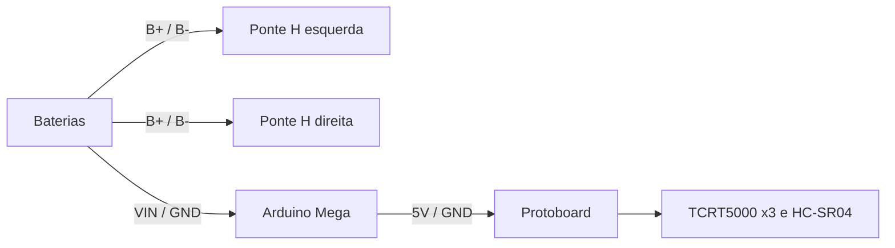
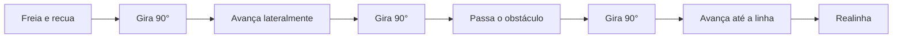

# Vitorino JR — OBR

Robô seguidor de linha baseado em Arduino Mega, com controle PD, pivô no eixo para curvas fechadas, travessia de gaps e desvio de obstáculos por ultrassom.

Autor: **ByGuizo**

---

## Sumário

1. [Materiais](#1-materiais)
2. [Alimentação](#2-alimentação)
3. [Motores e pontes H](#3-motores-e-pontes-h)
4. [Sensores](#4-sensores)
5. [Mapa de pinos](#5-mapa-de-pinos)
6. [Montagem](#6-montagem)
7. [Calibração](#7-calibração)
8. [Funcionamento do código](#8-funcionamento-do-código)
9. [Parâmetros principais](#9-parâmetros-principais)
10. [Solução de problemas](#10-solução-de-problemas)

---

## 1. Materiais

| Qtd | Componente | Função |
|:---:|---|---|
| 1 | Arduino Mega 2560 | Controlador |
| 2 | Ponte H BTS7960 (IBT-2) | Acionamento dos lados esquerdo e direito |
| 4 | Motor DC com redução | Tração (2 por lado, em paralelo) |
| 3 | Módulo TCRT5000 (saída analógica) | Leitura da linha |
| 1 | Sensor ultrassônico HC-SR04 | Detecção de obstáculos |
| 1 | Suporte para 2 baterias | Alimentação geral |
| 1 | Protoboard | Distribuição de 5 V / GND dos sensores |

---

## 2. Alimentação



| Origem | Destino |
|---|---|
| Bateria (+) | B+ das duas pontes H e VIN do Mega |
| Bateria (−) | B− das duas pontes H e GND do Mega |
| 5V / GND do Mega | Protoboard (alimentação dos sensores) |

**Importante:**
- Todos os GNDs (baterias, pontes H, Mega e sensores) devem ser comuns.
- Os sensores devem ser alimentados pela protoboard. Derivar o 5 V dos sensores de linha no mesmo fio do HC-SR04 causa queda nas leituras analógicas.
- Use fios de bitola maior na alimentação das pontes H e nos motores.

---

## 3. Motores e pontes H

Cada ponte H controla um lado do robô (acionamento diferencial). Os dois motores de cada lado são ligados em paralelo nos bornes M+ e M− da respectiva ponte.

### Controle

| Pino BTS7960 | Ponte esquerda | Ponte direita |
|---|:---:|:---:|
| RPWM | D5 | D9 |
| LPWM | D6 | D10 |
| R_EN | 5V | 5V |
| L_EN | 5V | 5V |
| VCC | 5V | 5V |
| GND | GND | GND |
| R_IS / L_IS | — | — |

O código não aciona `R_EN` e `L_EN`; ambos devem estar ligados diretamente ao 5 V.

### Potência

| Borne | Ligação |
|---|---|
| B+ / B− | Baterias |
| M+ / M− | Os 2 motores do lado correspondente, em paralelo |

**Verificação de sentido:** os dois motores de um mesmo lado devem girar no mesmo sentido. Se um lado inteiro girar ao contrário, inverta M+ e M− da ponte correspondente.

---

## 4. Sensores

### Sensores de linha (TCRT5000)

Três módulos alinhados em linha reta na frente do chassi, próximos ao solo, com o sensor central no eixo do robô. Utiliza-se a saída analógica (A0 do módulo); a saída D0 não é usada.

| Sensor | Pino do Mega |
|---|:---:|
| Esquerdo | A0 |
| Central | A1 |
| Direito | A2 |

VCC e GND de cada módulo vêm da protoboard.

### Ultrassônico (HC-SR04)

Montado na frente do robô, voltado para frente.

| Pino | Pino do Mega |
|---|:---:|
| VCC / GND | Protoboard |
| TRIG | D11 |
| ECHO | D12 |

O desvio de obstáculos vem desativado. Para ativar:

```cpp
#define USAR_ULTRASSONICO 1
```

---

## 5. Mapa de pinos

| Pino | Função |
|:---:|---|
| D5 | RPWM — ponte H esquerda |
| D6 | LPWM — ponte H esquerda |
| D9 | RPWM — ponte H direita |
| D10 | LPWM — ponte H direita |
| D11 | TRIG — HC-SR04 |
| D12 | ECHO — HC-SR04 |
| A0 | Sensor de linha esquerdo |
| A1 | Sensor de linha central |
| A2 | Sensor de linha direito |
| VIN | Bateria (+) |
| 5V | Protoboard, VCC / R_EN / L_EN das pontes H |
| GND | GND comum |

---

## 6. Montagem

1. Fixe os 4 motores no chassi e as duas pontes H, uma para cada lado.
2. Ligue os 2 motores de cada lado em paralelo nos bornes M+ / M− da ponte H correspondente.
3. Ligue as baterias em B+ / B− das duas pontes H e em VIN / GND do Mega.
4. Conecte RPWM e LPWM conforme o mapa de pinos e ligue R_EN, L_EN e VCC ao 5 V.
5. Leve 5 V e GND do Mega até a protoboard.
6. Instale os sensores TCRT5000 alinhados na frente e ligue-os em A0, A1 e A2.
7. Instale o HC-SR04 e ligue TRIG em D11 e ECHO em D12.
8. Confira se todos os GNDs estão em comum.
9. Carregue o código pela Arduino IDE (placa: *Arduino Mega or Mega 2560*).
10. Faça o primeiro teste com as rodas suspensas.

---

## 7. Calibração

Abra o Monitor Serial em **115200 baud**. A cada 200 ms o robô imprime:

```
ESQ     CEN     DIR     pos   base giro  dist  acao
58.     287P    61.     0     120  0     -1    reto
```

Legenda após cada leitura: `P` = preto, `b` = borda, `.` = branco.

Meça cada sensor sobre o branco e sobre o centro da fita preta, e ajuste:

| Constante | Valor |
|---|---|
| `BRANCO_REF` | Leitura no branco (ligeiramente acima do valor real) |
| `PRETO_REF` | Leitura no centro da fita preta |
| `LIMIAR` | Ponto médio entre branco e preto; acima dele conta como preto |
| `LIMIAR_ALERTA` | Acima dele conta como borda; deve ser menor que `LIMIAR` |

Recalibre sempre que mudar de pista, iluminação ou altura dos sensores.

---

## 8. Funcionamento do código

**Leitura.** Cada sensor é classificado como branco, borda ou preto, e sua leitura é normalizada entre 0 (branco) e 1 (preto). A posição da linha é calculada por:

```
pos = (direito - esquerdo) / (esquerdo + centro + direito)
```

Valores positivos indicam linha à direita; negativos, à esquerda.

**Controle PD.** Com a linha próxima do centro, o robô avança e corrige a direção com `giro = KP * pos + KD * Δpos`. A velocidade cai de `VEL_RETO` para `VEL_CURVA` conforme o desvio aumenta.

**Pivô.** Se o sensor central sai do preto ou a posição ultrapassa `POS_PARA`, o robô freia e gira no próprio eixo até se realinhar. Isso permite curvas de 90°.

**Cruzamento.** Com os três sensores no preto, o robô segue reto.

**Perda da linha.** Se o robô estava alinhado e reto pouco antes, o trecho é tratado como gap e ele segue reto. Caso contrário, gira para o último lado em que viu a linha; se não a encontrar dentro de `TEMPO_BUSCA`, desfaz o giro e segue reto.

**Desvio de obstáculo.** Com o ultrassônico ativo, um objeto a menos de `DIST_OBSTACULO` cm, confirmado em `CONFIRMACOES` leituras seguidas, inicia a manobra:



O lado do desvio é definido por `LADO_DESVIO` (`1` = esquerda, `2` = direita).

**Acionamento.** Todo movimento é definido por uma velocidade base e um giro:

```
motor esquerdo = base + giro
motor direito  = base - giro
```

---

## 9. Parâmetros principais

| Parâmetro | Efeito |
|---|---|
| `VEL_RETO`, `VEL_CURVA` | Velocidade em reta e em curva |
| `KP`, `KD` | Intensidade da correção PD |
| `POS_PARA`, `POS_SAI` | Quando entrar e sair do modo pivô |
| `GIRO_PIVO_MIN`, `GIRO_PIVO_MAX` | Força do giro no pivô |
| `FREIO_PWM`, `FREIO_MS` | Intensidade e duração da frenagem |
| `TEMPO_BUSCA`, `JANELA_GAP` | Comportamento ao perder a linha |
| `TEMPO_GIRO_90_ESQ`, `TEMPO_GIRO_90_DIR` | Calibração do giro de 90° no desvio |
| `TEMPO_LATERAL`, `TEMPO_PASSAR` | Distâncias percorridas no desvio |
| `DEBUG_SERIAL` | `1` ativa e `0` desativa a saída serial |

---

## 10. Solução de problemas

| Sintoma | Causa provável | Solução |
|---|---|---|
| Motores não giram | `R_EN` / `L_EN` desconectados | Ligar ambos ao 5 V |
| Motores com comportamento irregular | GND não comum | Unir GND de baterias, pontes H e Mega |
| Um lado gira ao contrário | Polaridade invertida | Inverter M+ e M− da ponte |
| Robô corrige para o lado errado | Sensores trocados | Verificar no Monitor Serial se A0 é o esquerdo e A2 o direito |
| Leituras analógicas muito baixas | Alimentação derivada | Alimentar os sensores pela protoboard |
| Não distingue branco de preto | Calibração ou altura do sensor | Recalibrar e aproximar o sensor do solo |
| Não desvia de obstáculos | Ultrassônico desativado | `#define USAR_ULTRASSONICO 1` |
